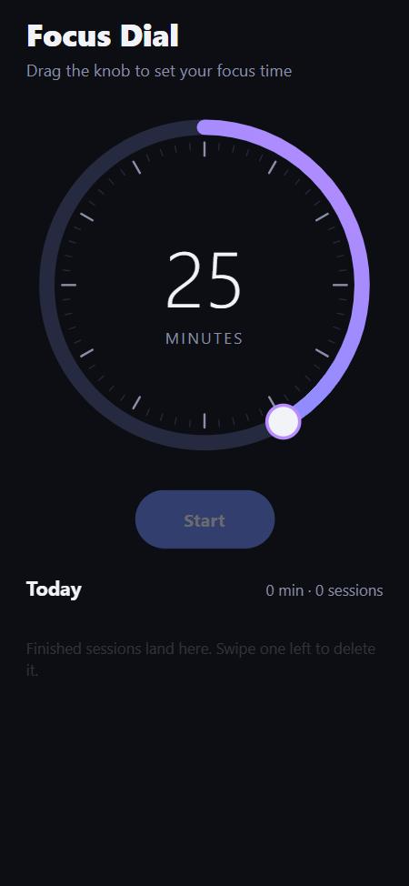
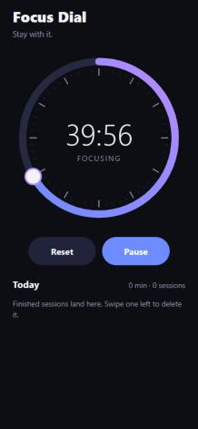

# Focus Dial

A small focus timer for iOS, Android and the web, built around one tactile
interaction: **drag a knob around a dial to set your focus time.** The countdown
arc, the knob, the springs and the gestures all run on the UI thread.

<p align="center">
  
  &nbsp;&nbsp;
  
</p>

## Why this project

I wanted to explore the libraries the React Native ecosystem relies on for fluid
interaction, so the whole app is built on them:

| Library | What it does here |
| --- | --- |
| [React Native Reanimated 4](https://docs.swmansion.com/react-native-reanimated/) | Countdown arc, knob position, springs, layout animations of the session list |
| [React Native Gesture Handler 3](https://docs.swmansion.com/react-native-gesture-handler/) | Dial drag through the new hook API (`usePanGesture`), swipe-to-delete with `ReanimatedSwipeable` |
| [React Native Worklets](https://docs.swmansion.com/react-native-worklets/) | `scheduleOnRN` sends minute changes from the UI thread to JS |
| [react-native-svg](https://github.com/software-mansion/react-native-svg) | Dial, ticks, gradient arc. Animated with `useAnimatedProps` |
| [Expo SDK 58](https://docs.expo.dev/) | Tooling, haptics, web support |

## Technical highlights

- **The JS thread sees almost nothing during a drag.** The pan callbacks are
  worklets. They map the touch point to an angle, update a shared value and
  move the arc and knob through `useAnimatedProps`. JS is called only when the
  selected *minute* changes, to update the label and fire a haptic tick.
- **One animation drives the countdown.** Starting the timer runs a single
  linear `withTiming` from the current value to `0` over the remaining time.
  Pause calls `cancelAnimation`, and resume starts a new timing for whatever
  is left. JS keeps only the wall-clock deadline, so the arc stays smooth even
  when the JS thread is busy.
- **No wrap-around glitch at 12 o'clock.** Dragging past the top stops at 60
  minutes or 1 minute instead of jumping to the other end (`clampWrap`).
- **Snaps to whole minutes with a spring** when you let go.
- **React Compiler friendly.** Shared values are accessed with `.get()` /
  `.set()`, so the strict `react-hooks` lint rules pass.
- **The geometry is pure and tested.** `src/lib/dial.ts` holds worklet
  functions that also run as plain functions, so they are unit-tested with
  Node's built-in test runner. No Jest setup is needed.
- **Synced with a backend, works without one.** Sessions are saved through
  [Focus Dial API](https://github.com/mayennscp/focus-dial-api) (Node.js,
  Fastify, SQLite), which also computes the daily streak. Updates are
  optimistic, and if the API is unreachable the app keeps working locally and
  says so.

## Project structure

```
App.tsx                     screen layout, wiring
src/components/Dial.tsx     SVG dial + pan gesture (UI thread)
src/components/SessionList.tsx  finished sessions, swipe to delete, layout animations
src/components/Button.tsx   spring-press button
src/hooks/useFocusTimer.ts  timer state machine (idle → running ⇄ paused)
src/hooks/useSessions.ts    today's sessions synced with the API, optimistic updates
src/lib/api.ts              typed client for the backend
src/lib/dial.ts             pure geometry worklets (+ dial.test.ts)
src/lib/haptics.ts          haptics, no-op on web
```

## Running it

```bash
npm install
npx expo start
```

Then scan the QR code with **Expo Go** on your phone (all native modules used
here ship with Expo Go), or press `w` to open the web version.

To save sessions and see your streak, run the
[backend](https://github.com/mayennscp/focus-dial-api) on the same computer
(`npm run dev` in its folder). The app finds it automatically on port 3000.
Set `EXPO_PUBLIC_API_URL` in `.env` to use another address (see `.env.example`).

```bash
npm test          # unit tests (node --test)
npm run typecheck # tsc --noEmit
npm run lint      # expo lint
```

## License

MIT
